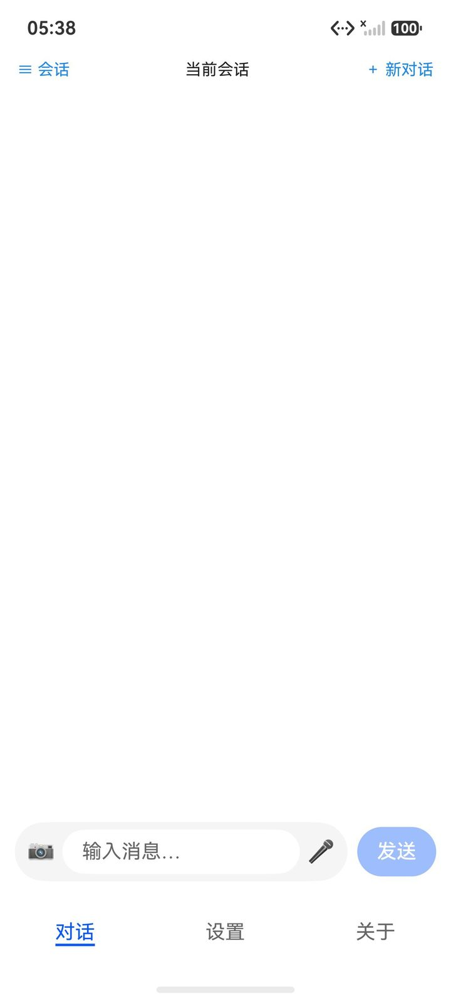
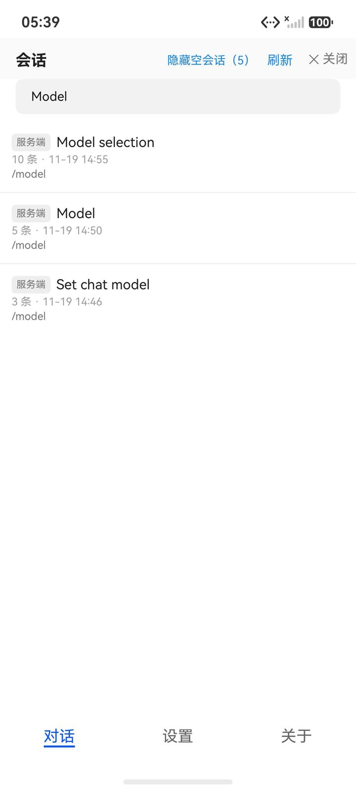
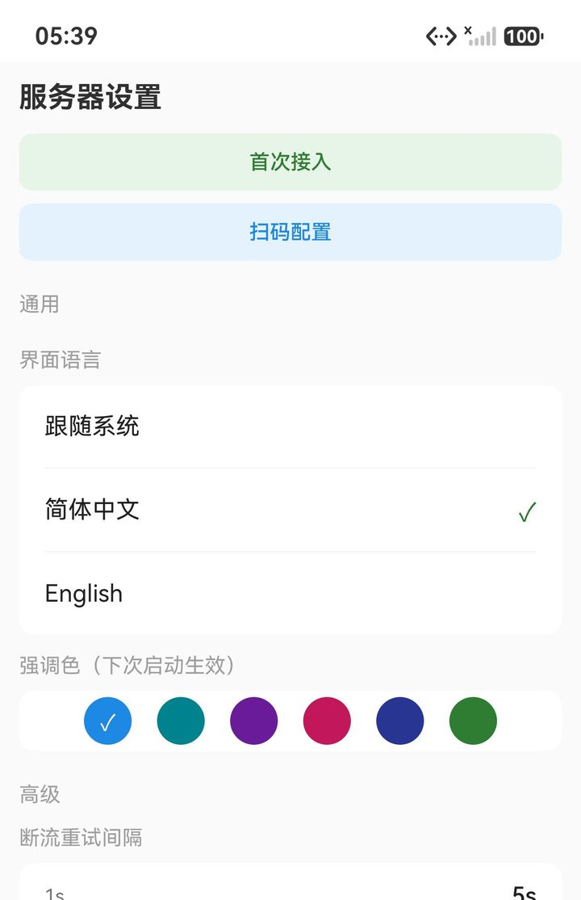

# HermesPaw

[](LICENSE)


> A native HarmonyOS client for the **Hermes Agent** gateway — pure ArkTS, zero third-party runtime dependencies.
>
> [中文文档](README.md) · English (this file)

HermesPaw is the mobile companion for a self-hosted [Hermes Agent](https://github.com/plastic-labs) gateway:
read agent progress from your phone, approve risky shell commands inside the approval window, and steer or
stop a run with `/steer` and `/stop` — without opening a laptop.

## Features

- **Zero-config pairing** — the gateway side prints a QR code; the phone scans it and is ready. No typing URLs or tokens.
- **Session panel aligned with Hermes** — server-side auto titles (`derived` → `llm` upgrade), local/server tags, search, empty-session filtering, long-press delete.
- **Approval cards** — dangerous commands surface as a card with four choices and a 60-second countdown; timeout fails closed.
- **Steer & stop** — inject a one-off instruction into a running turn, or cancel it; both go through the same REST endpoints the CLI uses.
- **Robust streaming** — the gateway does not push incremental deltas over the REST surface, so the client polls a baseline (`getRun`) with adaptive back-off and uses SSE only as an enhancement. Long silent turns no longer look "dead".
- **Restart-safe** — in-flight runs are re-attached after the app restarts or returns from background.
- **Multi-profile** — several gateways / profiles, switchable from the settings page.
- **Bilingual UI** — follows the system locale, or force 简体中文 / English in-app.
- **Privacy-first** — the gateway key is stored in HUKS (never in plain prefs); a single `LogSafe` facade is the only place that touches `hilog`, and it masks secrets.

## Screenshots

| Chat (new session) | Session list (search + local/server tags) | Settings |
|---|---|---|
|  |  |  |

> Captured on a HarmonyOS emulator (API 26); the UI is identical on a device. The middle shot shows keyword
> search, empty-session hiding, and the local/server tags.

## Requirements

- DevEco Studio 6.x (HarmonyOS 7 SDK). CLI builds need the three environment variables used by `tools/build.bat`.
- Phone: HarmonyOS 5.0+ (API 12+).
- A running Hermes gateway with its API server enabled and a bearer key configured.

### Plain HTTP on a LAN

The client talks to `http://` gateways on a local network. Official plaintext blocking via `network_config.json`
was introduced in 6.1.0(23); API 12–22 has no global blocker and allows it by default. If your device is
6.1.0(23)+ and blocks plaintext, add `src/main/resources/base/profile/network_config.json` allowing your private
subnet (see the 6.1.0(23) documentation).

## Build

1. Open the project in DevEco Studio (recommended: the IDE syncs hvigor / oh-package versions and sets up
   automatic signing on first open). Pure CLI builds work without launching the IDE first (`hvigorw` wrapper is
   committed).
   - `@ohos/hvigor` and `@ohos/hvigor-ohos-plugin` ship **with DevEco Studio** and are not published on the ohpm
     registry — they are intentionally absent from `devDependencies`. If your IDE writes them back as `file:` paths,
     that is local-only configuration.
2. Run from the IDE, or run `tools\build.bat` (Windows CLI chain: build + sign + install + launch).
3. `hdc install -r entry\build\default\outputs\default\entry-default-signed.hap` (build.bat does it for you).

### Signing

- DevEco's automatic signing writes **your local certificate path and password** into `build-profile.json5`
  (`signingConfigs`). That is machine-local — do not commit it; the repository keeps `signingConfigs: []`.
- Do not add the whole file to `.gitignore` either: it also carries `products` / `compatibleSdkVersion`.

## Test

```bash
make test      # all static self-tests, no device and no gateway required (15 scripts today)
make lint      # arkts-lint (40 .ets files, expects 0 findings)
make scan      # zero-credential / zero-internal-IP scan (run before every push)
```

Device unit tests (hypium, on a real device or emulator; they pin the pure-function contracts — title derivation,
polling cadence, slash-command parsing):

```bash
# 1) build the test package (or use DevEco: Run 'entry > ohosTest')
hvigorw --mode module -p module=entry@ohosTest -p product=default assembleHap
# 2) install and run
HDC=<your hdc> TARGET=<device ip:port> bash tools/ohostest.sh
# => Tests run: 18  Pass: 18  Failure: 0  Error: 0 / VERDICT: OK
```

> `hvigorw ... test` hangs after the build phase on DevEco 6.26.8 (no error, no exit), so the repository uses
> `assembleHap → hdc install → aa test` instead. The script wraps all three steps and prints a verdict.

## Security

- The gateway key lives in HUKS-backed storage (`store/TokenVault.ets`); preferences never hold the raw key.
- `utils/LogSafe.ets` is the only module allowed to call `hilog`; it masks tokens and long identifiers.
  A self-test enforces this invariant (any other file using `hilog` fails the gate).
- Pairing is QR-only by design — there is no "paste a URL and a token" field, so credentials never travel through
  screenshots or chat messages.
- Approval requests are fail-closed: on timeout the run is denied, not approved.

## Gateway setup

Enable the API server, create a bearer key, and let the phone reach the port (default `8377`).
The server-side helper that renders the pairing QR code is documented in `docs/server-setup.md`.

```bash
# Linux
sudo ufw allow from $NET to any port 8377 proto tcp
# WSL (mirrored networking)
sudo ufw allow in on loopback0
sudo ufw allow out on loopback0
#   loopback0 is required in mirrored mode: without it, local 127.0.0.1 traffic is treated as external inbound
#   and the CLI immediately reports "Gateway connection failed".
```

## App configuration

Scan the QR code on the settings page (**首次接入 / First-run** or **扫码配置 / Scan to configure**).
The dialog shows the connected profile name; if it shows "未连接 / Not connected", tapping any entry
(📷 / send / new session) triggers an automatic reconnect including a HUKS cold-start retry.

## License

MIT — see [LICENSE](LICENSE). Third-party references and their licenses are listed in
[`docs/third-party-references.md`](docs/third-party-references.md) (the app has **zero** third-party runtime
dependencies; the only vendored code is BSD-3 `segno` used by the QR helper script).

## Repository boundaries

- Internal material that is **not** distributed with this repository: `docs/test-reports/` (device/emulator
  evidence, contains private addresses) and `evidence/` (captured logs and payload samples). Both are gitignored
  and kept locally only.
- Design documents under `docs/` are implementation-level records in Simplified Chinese; they evolve with the code.
  Start from the English index: **[`docs/README.en.md`](docs/README.en.md)** — it says what each document
  answers, who it is for, and whether it is still authoritative (Simplified Chinese index: [`docs/README.md`](docs/README.md)).
