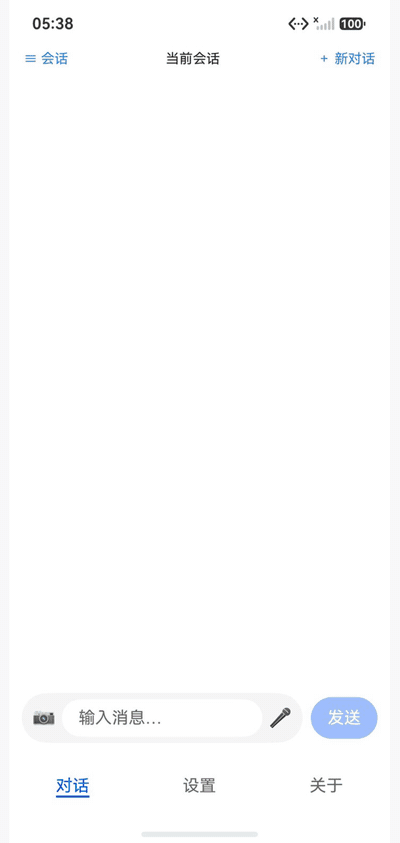
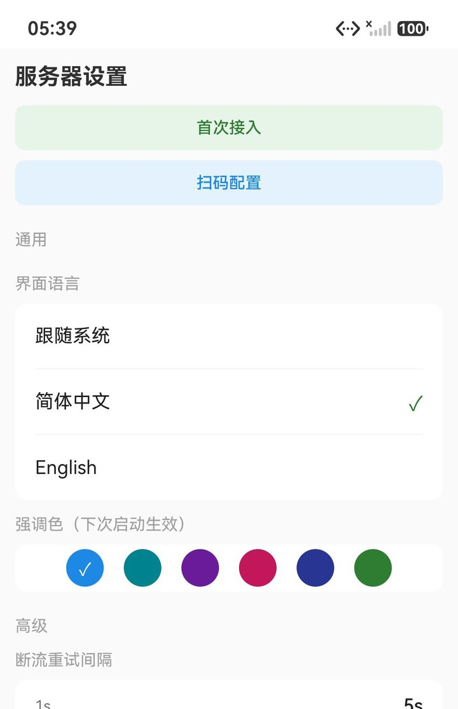

# HermesPaw

[](LICENSE)
[](https://github.com/pzmmy/hermes-paw/actions/workflows/selftest.yml)
> 中文（本文件） · [English](README.en.md)

HarmonyOS NEXT 原生客户端，对接 [Hermes Agent](https://github.com/NousResearch/hermes-agent) 网关。
纯 ArkTS，零第三方运行时依赖（全部使用 `@kit.*` 系统 API），单 HAP，体积目标 < 3MB。

**给谁用**：已经在跑 Hermes 网关的人。你人离开电脑、但还在同一个局域网（家里换个房间、在会议室、在沙发上），
手机上就能看到 run 在做什么、在 60 秒内批准或拒绝一条危险命令、`/steer` 插话纠偏，或者直接停掉。

它**不做公网中继、不经过第三方 IM**：手机与网关同网段直连。换来的是完整交互（run 生命周期、审批卡、
插话、会话列表与搜索）和不把对话内容交给别人；代价是离开这个网段就用不了。

## 30 秒看懂



## 三步上手（手机与网关在同一局域网）

1. **网关侧出码**（在跑 Hermes 的那台机器上，零依赖）：

   ```bash
   python3 tools/hermes-paw-qr --name home
   ```

   脚本会先自检 `/v1/models`，不通不出码——出得来码，基本就代表手机立刻能连。

2. **手机扫码**：App → 设置 → 扫码配置（或首次接入）→ 扫屏幕上的二维码。

3. **开始用**：回到对话页，顶部应显示「已连接：<你起的名字>」，发一条消息即可。

> 出码串里带长效 key：一次一人一码，不截图、不发群，用 `--once` 打完清屏。
> 网关侧细节（profile、监听地址、防火墙、排障表）见 [`docs/server-setup.md`](docs/server-setup.md)。


## 特性

- **S1 推送核心**：多服务器 profile（家庭局域网 / 公司局域网等，扫码接入多台）、SSE 流式对话、停止 / 新会话、SQLite 历史会话、步骤流、审批卡、`/steer` 插话、会话接手（扫码）、断线恢复（指数退避 2/4/8/16/30s 上限，审批等待期跳拍）
- **S2 碎片输入**：图片输入（选择 → 长边 1568 → JPEG q80 → base64 内联）、语音输入（端侧 ASR，增量转写进输入框）
- **统一错误文案**：网络类错误一句话呈现（原因 + 一个动作），原始细节只进 hilog
- **UI 设置**：应用内语言切换（跟随系统 / 中文 / 英文）+ 6 种强调色主题，均于下次启动应用时生效

## 截图

| 对话（新会话空态） | 会话列表（搜索 + 本地/服务端标签） | 设置 |
|---|---|---|
|  |  |  |

> 截图取自 HarmonyOS 模拟器（API 26），界面与真机一致；会话列表那张演示了
> 「搜索过滤 + 0 条会话隐藏 + 本地/服务端标签」。

## 前置

- DevEco Studio 6.x（HarmonyOS 7 SDK）；CLI 构建需三环境变量（见 `tools/build.bat`）
- 手机：HarmonyOS 5.0+（API 12+）
- 一个运行中的 Hermes 网关（API server 已开，Bearer key 已配）

### 明文 HTTP（局域网）

M1 连接 `http://` 网关。官方明文流量拦截配置机制自 6.1.0(23) 新增（`network_config.json`）、API 20 起 module.json5 支持 `networkSecurityConfig`；API 12-22 无全局拦截机制，默认放行明文，无需额外配置。若真机为 6.1.0(23)+ 且被系统拦截：新增 `src/main/resources/base/profile/network_config.json` 对私网段放行明文（见官方 6.1.0(23) 文档）。本轮首次真机运行即该验证点。

## 构建

1. DevEco 打开工程（推荐：首次打开 IDE 自动同步 hvigor / oh-package 版本并配置自动签名）；纯 CLI 构建无需先开 IDE（`hvigorw` 包装脚本已入库）
   - `devDependencies` 钉在 `@ohos/hvigor@6.26.8`：若你的 DevEco 自带版本不同，改成**本机版本号**即可（DevEco 各版本 hvigor 见 `<安装目录>/tools/hvigor/hvigor/package.json`），或直接在 IDE 里打开让引擎重写
2. IDE 运行按钮，或运行 `tools\build.bat`（Windows CLI 构建链，2026-10-28 真机实证：构建 + 签名 + 安装 + 启动全链通过）
3. `hdc install -r entry\build\default\outputs\default\entry-default-signed.hap`（build.bat 自动执行）

### 签名

- IDE 自动签名会把**本机证书路径 + 密码**写入根 `build-profile.json5`（`signingConfigs`）——属本机配置，**勿提交**；仓库基线保持 `signingConfigs: []`。
- DevEco 打开工程后若 `git status` 显示 build-profile.json5 有修改，不要提交该文件（也不建议整体 .gitignore：该文件还承载 products / compatibleSdkVersion 等共享配置，忽略会破坏 fresh clone 构建）。

## 测试

```bash
make test      # 静态自测全家桶（无设备、无网关；当前 15 组脚本）
make lint      # arkts-lint（40 个 .ets，0 findings 为通过）
make scan      # 零凭据 / 零内网 IP 扫描（push 前必跑）
```

设备单元测试（hypium，跑在真机或模拟器上，验证纯函数契约：标题派生 / 轮询节拍 / 斜杠命令解析）：

```bash
# 1) 打测试包（DevEco CLI 或 IDE 里 Run 'entry > ohosTest'）
hvigorw --mode module -p module=entry@ohosTest -p product=default assembleHap
# 2) 装包并执行
HDC=<你的 hdc> TARGET=<设备 ip:port> bash tools/ohostest.sh
# => Tests run: 18  Pass: 18  Failure: 0  Error: 0 / VERDICT: OK
```

> 注意：`hvigorw ... test` 这条官方任务在 DevEco 6.26.8 上会卡在构建阶段不退出，
> 所以仓库改用 `assembleHap → hdc install → aa test` 三步（脚本已封装，结果可判定）。

## 安全

- 服务器密钥：TokenVault（HUKS AES-256-GCM，CMK `hermespaw_cmk_v1` TEE 驻留）；明文 token 不落本地库 / 不落日志（P1-4）
- 无公网入口；局域网 + Bearer key 是唯一入口
- 仓库不含任何凭据；网关地址在 App 内配置
- EntryAbility `exported: true` 为 CLI `aa start` 拉起所必需（2026-10-28 真机实证），意味着其他应用可显式拉起本 Ability；内部自用场景可接受，Ability 内无敏感入口
- **系统备份不包含本应用数据**：HarmonyOS **没有** `allowBackup` 字段，备份能力须显式接入
  `BackupExtensionAbility` + `backup_config.json`（`allowToBackupRestore` 默认 **false**）。
  本应用**未声明**该扩展（`module.json5` 无 `extensionAbilities[type=backup]`）→ 备份恢复框架不会
  带走应用数据，HUKS 密文不会流向无法解密的环境。验收方式：打包产物中查不到 backup 扩展。

## 服务端配置（Hermes 网关）

前置（写死版本下限，别写"最新版"）：Hermes ≥ v0.22.5（api_server / runs 族契约）· systemd · python ≥3.12 · 手机与服务器同网段。

**一键（推荐）**：`python3 tools/hermes-paw-qr`（S0 交付物，零依赖，系统 python3 直接跑；2026-10-30 于 Hermes 网关 v0.22.5 实测）：

```
cd ~/git/hermes-paw
python3 tools/hermes-paw-qr --list     # 预检：四态（enabled/host/key/监听）
python3 tools/hermes-paw-qr --apply    # 四态对账缺啥补啥（幂等；有改动 → rc=2 + 提示人工重启网关）
tools/hermes-paw-qr            # 出码（单一档：default profile + 主 key，全功能）
python3 tools/hermes-paw-qr --prompt   # 接入提示词（目标式，贴给 Hermes 智能体委托配置）
python3 tools/hermes-paw-qr --json     # 机器模式（仅 URI，非 TTY 用；与 --png 互斥）
```

**手动逐条（或无脚本时）**——①-⑤⑦-⑨ 已于 Hermes 网关（v0.22.5）验证原样可执行（2026-10-30）：

② 开 api_server：

```
hermes config set platforms.api_server.enabled true
hermes config set platforms.api_server.extra.host 0.0.0.0
hermes config set platforms.api_server.extra.port 8377
```

③ 主 key（三分支幂等；≥16 字符是硬门槛；dotenv 取最后一条，重复追加会使已发出的所有码作废且无提示，必须先判定再写）：

```
if grep -qE '^API_SERVER_KEY=.{16,}' ~/.hermes/.env 2>/dev/null; then
  echo "API_SERVER_KEY 可用（≥16 字符），保留现值（不重写）"
elif grep -q '^API_SERVER_KEY=' ~/.hermes/.env 2>/dev/null; then
  sed -i '/^API_SERVER_KEY=/d' ~/.hermes/.env
  python3 -c "import secrets;print('API_SERVER_KEY='+secr...2))" >> ~/.hermes/.env
  chmod 600 ~/.hermes/.env
  echo "⚠️ 现存 key 不可用（<16 字符），已用新 key 覆盖——此前发出的所有码作废，需重发"
else
  python3 -c "import secrets;print('API_SERVER_KEY='+secr...2))" >> ~/.hermes/.env
  chmod 600 ~/.hermes/.env
fi
```

④ （v2.6.6 起作废）用户档：两档设计（guest 用户码 / 22 个 toolset 禁用）已取消——出码统一单一档（default profile + 主 key）。已存在的 guest 档案可继续用或忽略，不再新建；两档设计细节留档于方案 §4.7（节首作废注记）。

⑤ 防火墙（部署到其他机器时把网段改成本机实际网段）：

```
NET=192.0.2.0/24    # 示例网段：网关主机所在 LAN 段（改成实际网段）
# Linux：
sudo ufw allow from $NET to any port 8377 proto tcp
# WSL：
# （WSL 内）sudo ufw allow from $NET to any port 8377 proto tcp
# （WSL 内）sudo ufw allow in on loopback0
# （WSL 内）sudo ufw allow out on loopback0
#   ↳ loopback0 为 mirrored 模式必需：缺则本机 127.0.0.1 流量被当外部入站丢弃——
#     配完 hermes CLI 立即报 Gateway connection failed（v2.4.2 P1-D，前置为配置主体而非事后救火）
# （Windows 管理员 PowerShell）New-NetFirewallRule -DisplayName 'HermesPaw 8377' -Direction Inbound -Action Allow -Protocol TCP -LocalPort 8377 -RemoteAddress 192.0.2.0/24 -Profile Public   # 此行不继承 bash $NET（PowerShell 不认），改网段须手动改 -RemoteAddress
```

⑧ 重启（必须人工，脚本不会替你做；任何配置/key 改动都需重启才生效）：

```
hermes gateway restart
```

完整手册（脚本全 flags、URI 六字段契约、安全边界诚实口径、排障表 6 项）→ `docs/server-setup.md`。

## App 侧配置（手机）

推荐（委托式接入，用户全程只做两件事：贴提示词 + 收码扫码）：
1. 复制 App 引导页的目标式接入提示词（或服务端 `python3 tools/hermes-paw-qr --prompt`）
2. 贴给目标网关的 Hermes 对话——agent 自主完成配置 + 预检 + 出码，回传二维码图片（通道不可发图则回传 hermespaw:// 配置串）
3. HermesPaw「收到二维码，去扫码」（引导页）或「扫码配置」（设置页）→ 相机扫码 / 相册识码 / 粘贴配置串 → 确认卡（可达性探测 + 四因诊断）→ 确认即保存并激活

要点：
- 设置页的**档案列表为只读展示**：查看已存档案的名称 / 地址 / profile / 激活态，行级动作 = 诊断 / 激活 / 删除（带确认）；不提供手动地址 + Token 输入（扫码为唯一路径，v2.6.6）。页面另含两项外观设置：语言切换（跟随系统 / 中文 / 英文）与强调色（6 种主题），均于下次启动应用时生效
- 要连不同配置（多个 Hermes 实例 / 多个 profile）：提示词第 1 条已要求 agent 列候选让你选
- 对话页顶部显示「已连接：〈档案名〉」即就绪。若显示「未连接」，无需回设置页重激活：点任意入口（📷 / 发送 / 新会话）会触发一次自动重连（含 HUKS 冷启动重试，2026-11-01 家庭网 E2E 修复）

## 许可

MIT（见 `LICENSE`）。第三方引用与许可清单见 `docs/third-party-references.md`
（App 运行时零第三方依赖；工具脚本仅 vendor 了 BSD-3 的 segno 用于生成二维码）。

## 仓库边界

- 不随仓库分发的内部材料：`docs/test-reports/`（真机/模拟器实测证据，含内网地址）、
  `evidence/`（运行时抓包与日志样本）。二者已在 `.gitignore` 中，本地保留、入库与外发都排除。
- 设计文档保留在 `docs/` 下，属实现层事实记录，可能随代码演进更新；
  中文索引页（每篇文档回答什么问题、给谁看、是否仍为准）→ **[`docs/README.md`](docs/README.md)**；
  英文索引 → [`docs/README.en.md`](docs/README.en.md)。
- 版本变更见 [`CHANGELOG.md`](CHANGELOG.md)。
- 想参与开发看 [`CONTRIBUTING.md`](CONTRIBUTING.md)（三种检查怎么跑、CI 为什么不编译 HAP）；安全问题走 [`SECURITY.md`](SECURITY.md) 的私密渠道。
