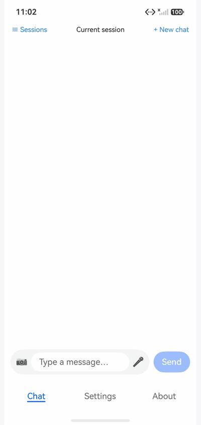

# I built a HarmonyOS client for my AI agent — and gave up on streaming output

> Draft v1 (English) | for dev.to
> Code: <https://github.com/pzmmy/hermes-paw> (MIT, pure ArkTS, zero third-party runtime dependencies)

---

Last Wednesday, 9pm, I was downstairs picking up a parcel. My phone buzzed: the Hermes agent wanted to run `chmod -R 777`, and it was waiting for my confirmation.

To approve it I had to walk back up to the study, open the laptop, and click a button. By the time I got there the approval had timed out and been denied by default. The task started over.

The problem was not "I have nowhere to chat with my agent" — WeCom and WeChat both do that fine. The problem was that I had **no remote control**: nothing that shows what the run is doing and lets me decide, right there, on the phone.

So I wrote HermesPaw: a native HarmonyOS NEXT client. Pure ArkTS, no third-party runtime dependencies, MIT licensed.

## What it deliberately does not do

It is **not** a public relay and it does **not** go through any third-party messenger. The phone must be on the **same LAN** as the machine running Hermes. Outside that subnet, it cannot connect.

That is a decision, not an unfinished feature. An approval is a decision a human should make within tens of seconds; exposing that path to the public internet only enlarges the risk.

## Then why not just use WeCom / WeChat?

This is the first question I get, and it deserves a precise answer.

**WeCom does support exec approval.** I checked the gateway source: it sends a **plain-text prompt with four choices** (once / this session / always / deny). You reply `/approve` — or simply `yes` — to approve, `/deny` to deny. The gateway's default window is **300 seconds**, and a timeout means **deny**.

It works, and it is genuinely convenient. But there are four ways it quietly goes wrong:

1. **No global state.** In a chat window, an approval prompt gets buried by the next few messages. You may not even remember you are blocked on a pending decision.
2. **The window is long.** 300 seconds is plenty of time for something else to happen — and for you to approve "on autopilot" without re-reading the command.
3. **No ticking clock.** The deadline is printed, but it is static. Nothing gets more urgent as the seconds drain.
4. **Typing on mobile.** `/approve` on a phone keyboard is slower than a tap, and it requires remembering the syntax.

So the two are **complementary, not competing**:

- Off-network (commuting, travelling), you only need notifications and instructions → use the messenger channel; it has push and works anywhere.
- On the LAN but away from the desk (another room, a meeting, the sofa) → use HermesPaw; it has the deep controls.

I wrote the full ten-row comparison — install, network, push, approval, stop, steer, history, long output, multi-gateway, exposure — with a gateway source location behind every claim: `docs/channel-comparison.md`. Pull requests welcome if you find an error.

## Three things you cannot get elsewhere

### 1. An approval card: four choices, 60 seconds, deny by default

When a dangerous command triggers approval, the app shows a card:

```
Approval required
chmod -R 777 /tmp/example
[Approve once] [Approve for session] [Always allow] [Deny]
                   60s left · auto-deny on timeout
```

All three paths were verified on real hardware:

- **Approve** → target directory `700 → 777`, command exit code 0.
- **Deny** → directory stays `700`, the model explicitly does not retry.
- **Do nothing** → auto-denied at 60s, directory stays `700`.

There was a nasty bug on the way: the gateway returns the approval data in `pending_controls`, not in a top-level `approval` field. My first version went with intuition, and the card simply never appeared. Reading the gateway source settled it.

### 2. `/steer` — correct course without restarting

If the agent is drifting, you do not have to stop it and re-ask. Type a sentence into the input box and it is a steering message: the run continues, but under the new instruction.

```
Inserted
Steering message not accepted
```

Both states are echoed. A steering message with no echo is indistinguishable from one that was never delivered.

### 3. Run state and timestamps — know what it is actually doing

The status bar has exactly three states: **has deltas** / **no deltas** / **fallback**. Every message carries a timestamp:

```
received 10:26:44 · took 639.3 s
```

Why does "639.3 s" matter? Because "looks stuck" and "is stuck" are different things. That run went for ten minutes; the status bar kept moving, so I knew it was alive. That is worth more than any spinner.

(A real data point: during one long answer, `outLen` stayed 0 for 393 seconds; the server eventually reported 19,611 output tokens. The app was not stuck — the model was still generating. By design the client never imposes a wall-clock limit; it only looks at run status.)

## Three steps to run it (phone and gateway on the same LAN)

```
# 1. Emit the pairing code on the gateway host (zero deps; it self-checks first)
python3 tools/hermes-paw-qr --name home

# 2. Scan it: Settings → Scan to configure
# 3. Back on the Chat tab, the top bar shows "Connected: home"
```



The pairing string carries a long-lived key: one person, one code. Do not screenshot it or paste it into a group chat.

## The engineering part (20% of this post, and my favourite bit)

### Why I gave up on streaming output

In week two I spent most of my time on SSE, chasing the dream: the model emits a token, the screen shows a token.

It does not work, and the evidence is unambiguous:

- The SSE connection **stays alive** end-to-end — first byte at 0.07 s, 3,039 bytes over 35 s, contiguous `seq`.
- But **zero delta frames**, and `outLen` stays 0 throughout.
- The `getRun` snapshot's `output` is empty mid-run too; **it is only filled at the terminal state**.

In other words, the gateway's REST surface does not push token deltas. Without deltas, SSE degrades to a liveness probe.

So I inverted the transport hierarchy: `getRun` polling became the baseline (P50 14.75 ms, 10 calls, 0 failures), and SSE was demoted to an enhancement. The worst case went from "SSE fails + 30 s idle timeout" to "one getRun". Polling starts at 2 s, backs off to a 5 s cap, resolves immediately on a terminal state, and stops when the app goes to the background.

This is not "I failed to build streaming". It is **knowing where the boundary is and moving the effort somewhere it pays** — waiting-state UI and timestamps.

### Why the app no longer names sessions

My first version gave every new session a placeholder title, `New chat 70384`. As a result the server-side auto-naming never kicked in: a placeholder title locks `set_auto_title`.

The fix was to **send no title at all**, letting the server derive one from the first meaningful line (≤48 chars) and then upgrade it to 3–7 words with an aux model. New sessions now come back with `title_source=llm` and titles like "Confirm end-to-end testing ok" instead of a timestamp.

### 206 hardcoded Chinese strings: i18n for a non-web frontend

HarmonyOS `$r('app.string.x')` only works in declarative UI — not in the ViewModel or the network layer. So every error message, status label and bubble suffix began life as a hardcoded Chinese literal: **206 of them**.

The fix: a small `Msg` facade (resource manager injected at startup, then `Msg.t('key')` everywhere), with all text in three `string.json` sets (`base` / `zh_CN` / `en_US`, 345 keys each), plus a gate that enforces: identical key sets across locales, no Chinese left in `en_US`, no Chinese literals in code, and every `Msg.t` key actually defined.

Two traps worth recording:

- Resource names **cannot contain dots** (only `[a-zA-Z0-9_]`); my first attempt failed at packaging.
- After stripping dots, the new keys collided with 163 existing ones; everything new got an `m_` prefix.
- Regex replacement also treated **quotes inside comments** as string delimiters and mangled a comment line. The only reliable approach was a four-state lexer (code / string / line comment / block comment).

## Finally

The app is small: 45 `.ets` files, zero third-party runtime dependencies, a single HAP. It is also imperfect: LAN-only, no push, no streaming.

But it solves one very concrete problem: **when I am not at the computer, I can still be responsible for this agent.**

If you run Hermes, give it a try. If you are happy with the WeCom/WeChat channel, that is entirely reasonable — it is a mature path, just a different one.

- Repo: <https://github.com/pzmmy/hermes-paw> (MIT)
- Design and measurement records: `docs/refactor-design.md`, `docs/impl-status.md`
- Channel comparison: `docs/channel-comparison.md`
