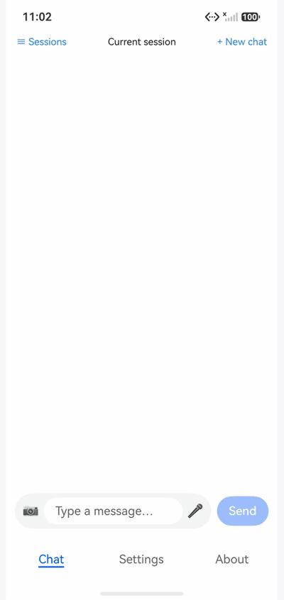

Xiao Ming runs the business side of a mid-sized company. It's halfway through a quarterly review and he can't stop thinking about the report he threw at Hermes Agent at 8am.

It's a fine job for an agent. Pull numbers from the business database, reconcile them against the agreed definitions, hand back an Excel file and a slide deck. Done by hand it takes two interrupted days, mostly waiting on data, chasing discrepancies, redoing formats. Now it's one morning.

The problem is that the job also touches things. It writes into a shared folder, cleans up old versions, runs a few scripts. Xiao Ming doesn't trust an agent to do that unwatched.

At 10:10 his phone buzzes on the table. The agent wants to delete last quarter's archived reports and it's sitting there waiting.

The card shows the command, `rm -rf reports/2026-09/`, plus a line of reasoning: "avoid mixing the two reporting periods." In a way that line matters more than the command, because he can't read `rm -rf`.

There's no laptop in the meeting room. It's a ten-minute walk back to his desk. By the time he gets there the approval has timed out, been denied, and the job is starting over.

So Xiao Ming wrote a client himself.

## What it can't do

Same LAN only. If the phone and the machine running Hermes are on the same subnet, it works. Step outside that subnet and you've got a brick.

That was his call, not a missing feature. An approval is something a human should settle in tens of seconds. He's not putting that on the open internet.

## But why not just use WeCom?

Fair question. He thought so too at first.

WeCom does support exec approval. He read the gateway source to be sure. It posts a four-choice prompt into the chat, you reply `/approve` or `/deny`, and it also accepts a plain `yes`. Default window is 300 seconds, and a timeout means deny.

It works. He just found a few places that felt wrong.

An approval prompt in a chat gets buried by the next three messages. By the time you scroll back, you may have already approved something else out of habit. 300 seconds sounds generous until you're in a meeting and five minutes slip by without you noticing. The deadline is printed, but it doesn't move. Nothing gets more urgent as the seconds run out.

The last one is what kills it for someone like Xiao Ming. He'd have to remember `/approve`. He won't.

So the two split the work. Off-network, travelling, you only need a notification and a one-line instruction, and the messenger channel wins there, it has push and it works anywhere. In the office but not at your desk: the client.

He wrote up the full comparison, ten rows, with a gateway source location behind each claim: `docs/channel-comparison.md`. Happy to be corrected.

## The approval card

A dangerous command triggers a card. Four choices: this time, this session, always, deny. Underneath, a 60-second countdown that auto-denies at zero.

He checked all three paths on real hardware. Approve: the target directory goes from `700` to `777`, exit code 0. Deny: it stays `700`, and the model says it won't retry. Walk away: auto-denied at 60 seconds, directory still `700`.

There was a bug on the way that still annoys him.

The gateway returns approval data in `pending_controls`, not in a top-level `approval` field. He wrote it the intuitive way, and the card simply never appeared. No error in the log, nothing. He spent a couple of hours reading the gateway source before the field name jumped out. After that it worked first try.

He's been a little suspicious of "no error, no effect" ever since.

## Steering

When the agent drifts, you don't have to stop it and start over. Type a sentence into the input box and it becomes a steering message; the run keeps going, under the new instruction. The app echoes one of two things: `Inserted`, or `Steering message not accepted`. Both matter. A steering message with no echo is indistinguishable from one that never arrived.

## The app itself was built through chat

Xiao Ming didn't want to install a dedicated app to manage the agent, and didn't want to learn another toolchain just for this. He was already away from his computer while the agent on that machine was still waiting for his approval — the most natural entry point was the chat box.

So this client itself was built through chat-as-programming. Not the "I wrote a spec doc and handed it to the agent" kind of semi-automation. Xiao Ming typed one sentence at a time into the chat box: "Add an approval card, four choices, countdown underneath" "Patch the SSE reconnect" "Change this error message to Chinese" — the agent wrote code, fixed code, ran tests, and Xiao Ming verified on real hardware.

So the app is both a product of chat-as-programming and a carrier of it. The tool that built it and the thing it does once running are the same thing.

## Status and timestamps

The status bar has three states: deltas arriving, no deltas, fallback. Every message carries a timestamp, `received 10:26:44 · took 639.3 s`.

Why care about the 639.3? Because "looks stuck" and "is stuck" are different problems.

That run went for ten minutes. He watched the log the whole time: `outLen` stayed 0 for 393 seconds straight. Any "no output for N seconds, kill it" rule would have killed a healthy run. The status stayed `running`, and the server eventually reported 19,611 output tokens. It wasn't stuck, it was writing.

So the client doesn't have a wall-clock limit. It looks at run status, nothing else.

## Getting it running

Phone and gateway on the same LAN, then:

```bash
python3 tools/hermes-paw-qr --name home
```

It probes `/v1/models` first and refuses to print a code that can't work, so if you get a code the phone can connect.

Scan it under Settings, go back to the chat tab, the top bar reads `Connected: home`.



The pairing string carries a long-lived key. One person, one code. Don't screenshot it, don't paste it into a group.

## The engineering

### He gave up on streaming

Week two, he spent most of his time on SSE, chasing the obvious thing: the model emits a token, the screen shows a token. It doesn't work, and the evidence was boringly clear.

The SSE connection stayed alive end to end. First byte at 0.07 seconds, 3,039 bytes over 35 seconds, contiguous `seq`. And zero delta frames. `outLen` stayed at 0 the whole way. He also checked the polling snapshot mid-run, `output` is empty there too, and only fills in at the terminal state.

So the gateway's REST surface doesn't push token deltas at all. Without deltas, SSE is a liveness probe with extra steps.

He inverted the hierarchy. Polling became the baseline, SSE an enhancement. One differential measurement: 10 calls, 0 failures, P50 around 15 ms, worst 39.6 ms. That was a one-off manual run and he never turned it into a script, so he only claims "about 15 ms" in the docs.

Polling starts at 2 seconds, backs off to a 5-second cap, resolves the moment the run reaches a terminal state, and stops when the app goes to the background.

He didn't fail at streaming. The road was closed. He spent the effort on the waiting UI and timestamps instead, which at least tell you the thing is alive.

### Let the server name the session

My first version gave every new session a placeholder, `New chat 70384`. Which meant the server's auto-naming never ran, because a placeholder title locks `set_auto_title`.

The fix is to send no title at all. The server derives one from the first meaningful line, 48 characters max, then an aux model upgrades it to three to seven words. New sessions now come back with `title_source=llm` and titles like "Confirm end-to-end testing ok" instead of a timestamp.

### 206 hardcoded strings

HarmonyOS `$r('app.string.x')` only works in declarative UI, not in the ViewModel, not in the network layer. So every error message, status label and bubble suffix started life as a hardcoded Chinese literal. He counted later: 206 of them.

The fix isn't clever. A small `Msg` facade that takes the resource manager at startup, then `Msg.t('key')` everywhere. All text lives in three `string.json` sets (`base`, `zh_CN`, `en_US`, 345 keys each), and a gate checks four things: identical key sets, no Chinese left in `en_US`, no Chinese literals in code, and every `Msg.t` key actually defined.

The traps were all in the details. Resource names can't contain dots, only letters, digits, underscore, and his first attempt failed at packaging with a one-line error. Strip the dots and the new keys collide with 163 existing ones, so everything new ended up with an `m_` prefix.

The worst part was the bulk replacement. He used a regex, and the regex treated quotes inside comments as string delimiters. It turned a comment line into a fragment of `Msg.t('...')`. He broke a dozen spots before noticing. Reverted the whole thing and wrote a four-state lexer instead: code, string, line comment, block comment. That version was clean.

## Anyway

The app is small. Around forty ArkTS source files plus 4 device-test files, zero third-party runtime dependencies, a single HAP. It's also imperfect: LAN only, no push, no streaming.

But it fixes one specific annoyance of his. When he's not at the computer, he still wants to be responsible for this agent.

If you run Hermes, give it a try. If you're happy with the WeCom or WeChat channel, that's fair too. It's a well-worn path, just a different one.

- Repo: <https://github.com/pzmmy/hermes-paw> (MIT)
- Design and measurement records: `docs/refactor-design.md`, `docs/impl-status.md`
- Channel comparison: `docs/channel-comparison.md`